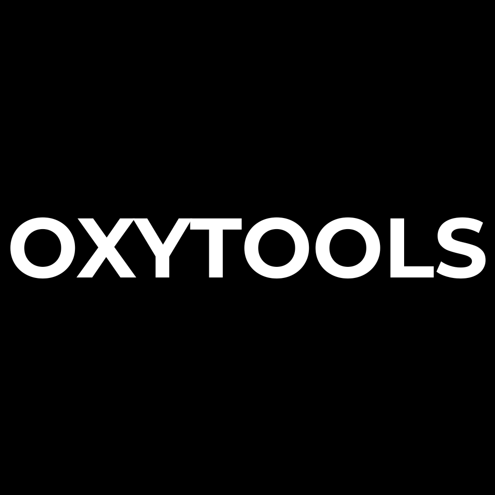

# Oxytools_full & Oxytools_Office

# Oxytools

Oxytools_full is a Rust portable GUI toolkit that brings together a collection of tools such as conversion, renaming, tagging, and scraping, with bundled binaries (ffmpeg, ffprobe, mkvpropedit).

Oxytools_Office is a restricted version of Oxytools_full with fewer modules, and does not include an API or network connectivity. It is designed for professional use.

---

## Languages supported
- English
- French

---

## Modules and key differences

| Differences | Oxytools_full | Oxytools_Office |
|--------|:-----:|:----------:|
| Archives (7Z, TAR, ZIP) | ✅ | ✅ |
| Audio (AAC, FLAC, MP3, OGG) | ✅ | ❌ |
| Documents (DOCX, HTML, MD, LaTeX, ODT, PDF...) | ✅ | ✅ |
| File renamer (case, find, insert, numbering, replace...) | ✅ | ✅ |
| Pictures (JPG, JXL, PNG, WebP…) | ✅ | ✅ |
| Scraper (Fanart, TMDB) | ✅ | ❌ |
| Tagger (MKV tagging) | ✅ | ❌ |
| Video (mkv, mp4, webm) | ✅ | ❌ |
| Bundled binaries (ffmpeg, ffprobe, mkvpropedit) | ✅ | ❌ |
| Internet access | ✅ | ❌ |

---

## Platforms

|| Linux x64 (Flatpak) | Windows x64 |
|---|:---:|:---:|
| Oxytools_full | ✅ | ✅ |
| Oxytools_Office | ✅ | ✅ |

---

## Building from source

You need those binaries to build:
- FFmpeg, FFprobe : https://ffmpeg.org — LGPLv2.1+
- mkvpropedit (MKVToolNix) : https://mkvtoolnix.download — GPLv2

You can also find them in the assets of the releases.

| Version | Command |
|---|---|
| Oxytools_full | `cargo build --release` |
| Oxytools_Office | `cargo office` |

The executable is generated in `target/release/`.

---

## Quick Start

1. Download the latest release from [Releases](../../releases)
2. Run it:
   - Windows: run the `.exe` - no installation needed
   - Linux: install the Flatpak with `flatpak install --user Oxytools_full_Lin-x64.flatpak`, then run `flatpak run io.github.Promethyxx.OxytoolsFull` (`OxytoolsOffice` for Oxytools_Office)
3. Drop your files or browse to select them
4. Choose your output format
5. Click "Execute"

---

## License

This project is licensed under the GNU General Public License v3.0 — see Licenses.md for details.

---

## Roadmap
## 🔴 NOW
   #- tag.rs
      - fix tagging efficiency
      - shell extension
      - Tag management, complete custom field, add field
   #- renamer move button up next to reinitialize
## 🟡 NEXT
 - ### Release:
    - Chocolatey
    - MS Store
    - Winget
## 🔵 LATER
---
